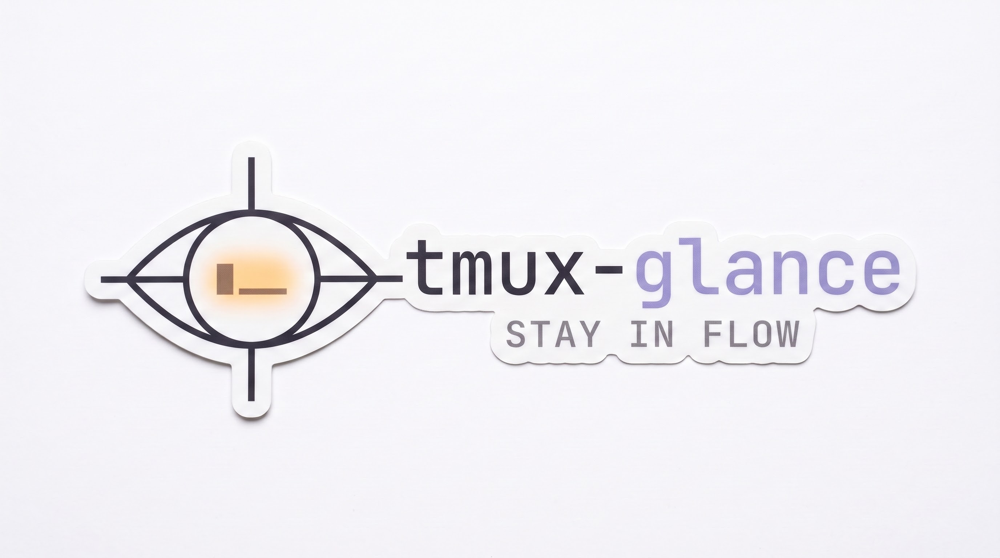
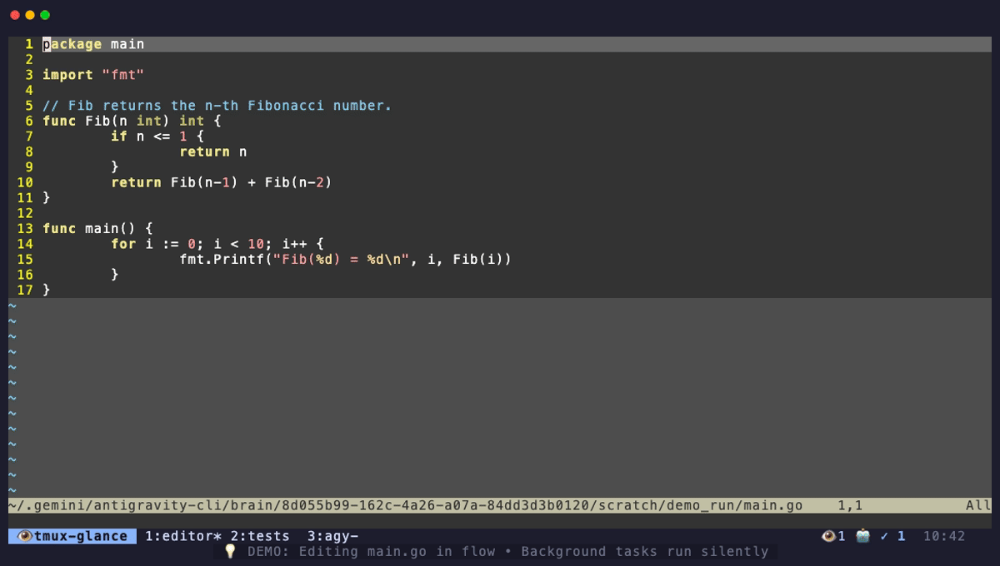

# 👁️ tmux-glance

<p align="center">
  
</p>

<p align="center">
  <strong>Instant cross-session navigation, crystal-ball pane peering, background build watches, and zero-setup AI agent orchestration for tmux.</strong><br>
  <em>Stop speculative window hopping. Preview live output, then jump straight there.</em>
</p>

<p align="center">
  
</p>
<p align="center">
  <sub><em>💡 <strong>In Action:</strong> Status bar alerts trigger while in flow (<code>main.go</code>) → <code>prefix b</code> opens the Attention Hub viewfinder with live ANSI preview → <code>Enter</code> teleports into the agent prompt to approve.<br>(Note: The bottom <code>💡 DEMO</code> subtitle bar illustrates keypresses and narration for this demo; <code>tmux-glance</code> itself lives ambiently in your status bar).</em></sub>
</p>

---

## Why tmux-glance? Three Levels of Power

`tmux-glance` upgrades how you move through and monitor `tmux`. Its benefits compound with how you use the terminal:

### 1. ⚡ Instant Server-Wide Navigation *(Powerful for Every Tmux User)*
Even if you never run background jobs or AI coding CLIs, `tmux-glance` eliminates cycling through windows (`prefix n` / `prefix p`) or hunting across sessions:
- **Universal Go-To Teleporter (`prefix g`):** Fuzzy-search across **100% of panes** in every session and window by directory name, repository, session, window, or running command.
- **Crystal-Ball Live Preview:** Peer into any pane's live, colorized terminal output (`--preview-window=:follow`) *before* you leave your current workspace, then press `Enter` to teleport straight there.
- **Workspace Sessionizer & Harpoon Slots (`Ctrl-s` / `Ctrl-p`):** Switch sessions in-modal or pin your top 4 workspaces to instant 1-chord shortcuts (`prefix C-h`, `C-j`, `C-k`, `C-l`) with zero config edits.
- **Vim-Style Jumplist Backtracking (`Ctrl-h` / `prefix Tab` / `prefix <` & `>`):** Every teleport is recorded in a deduplicated MRU jump stack (`FWD` / `CUR` / `BACK`), so you can jump to any pane on the server and rewind right back where you came from.

### 2. 🎯 Background Task & Build Watches *(More Powerful with Background Jobs)*
When you run long compilations (`cargo build`, `nix build`, `go test`), database migrations, or log tails in other panes, you shouldn't have to keep checking on them:
- **One-Key Vigil Watches (`prefix v`):** Press `prefix v` on any pane to put a watchful sentinel (`👁️`) on it and jump back to your editor.
- **Instant Output Alarms (`🚨`):** As soon as the background pane prints new output or finishes, your status bar flashes `🚨 1`.
- **Quickfix Triage & Dwell Auto-Ack:** Open the **Attention Hub (`prefix b`)** to preview the output, or cycle straight through active alerts with repeatable quickfix chords (`prefix }` / `prefix {`). Simply focusing the pane for 500ms automatically acknowledges and clears the alert—while rapidly whizzing past panes leaves alerts untouched.

### 3. 🤖 Zero-Setup Coding Agent Orchestration *(Even More Powerful with AI Agents)*
When you have autonomous coding agents running in the background across multiple repositories, `tmux-glance` becomes an ambient mission control with **zero manual setup**:
- **Automatic Discovery:** Automatically detects background agent sessions (built-in native support for Antigravity via process-tree inspection, plus zero-code `@glance_routes` mapping for custom wrappers or other agent CLIs).
- **Semantic State Tracking:** Distinguishes whether background agents are actively executing (`⚡ running`), blocked waiting for your confirmation or tool approval (`⏳ waiting`), or finished with unread output (`✓ finished`).
- **Intelligent Thought & Spinner Normalizer:** Strips animated braille spinners (`[⠋⠙⠹...]`) and streaming `"Thinking..."` lines before fingerprinting screen buffers, ensuring your status bar stays quiet until an agent genuinely needs your input or completes its turn.

---

## The Problem: Speculative Window Hopping

As terminal workflows scale across multiple repositories, background builds, test suites, and coding agents, developers suffer from **speculative window hopping**—repeatedly cycling `prefix n`, `prefix p`, or switching sessions just to check:

> _"Which session had my backend repo open? Did my build finish? Did that background test fail? Is an agent blocked waiting for confirmation?"_

Every speculative jump breaks concentration.

## The Solution: Ambient Glanceability & Live Viewfinders

`tmux-glance` embeds minimal, sub-50ms telemetry directly into your tmux status bar:

```
[10:42]  🚨 1  👁️ 1  🤖 ⏳ 1  ⚡ 2  ✓ 1
```

If the status bar is quiet, you stay focused on your active code. Badges follow a **User-First Domain Clustering** order—manual user vigils lead on the left, followed by autonomous background agents grouped inside a single deduplicated `🤖` capsule:

- `🚨 1` — A pane under **Vigil** just printed new terminal output or exited!
- `👁️ 1` — Panes actively being watched under Vigil in the background.
- `🤖 ⏳ 1` — A background agent is blocked **waiting for confirmation or approval**.
- `⚡ 2` — Background agents actively running tools or subagents.
- `✓ 1` — An agent completed its task or produced unread output while idle.

With one keystroke (`prefix b` for the **Attention Hub**, or `prefix g` for **Global Panes**), open the floating viewfinder popup to see prioritized panes, inspect their live ANSI output stream in real time, and press `Enter` to teleport straight there.

---

## Default Keybindings

`tmux-glance` registers only three non-disruptive Tier 1 keychords by default, never hijacking built-in tmux keys:

| Key | Action | Description |
| :--- | :--- | :--- |
| `prefix g` | **Global Panes (Go-To)** | Server-wide teleporter across 100% of panes in every session and window. Active tasks sort to top; preview live output and jump straight there. |
| `prefix b` | **Attention Hub** | Central dashboard for all panes needing attention: active vigils and agent tasks, sorted strictly by priority (`🚨`, `🤖 ⏳`, `🤖 ✓`, `🤖 ⚡`, `👁️`, `🤖 💤`). |
| `prefix v` | **Toggle Vigil** | Slap a watchful sentinel on the current pane (or release it). |

> **Inside the Viewfinder Popup:**
> * `Ctrl-g` — Toggle between Global Panes (all) and the Attention Hub.
> * `Ctrl-s` — Switch to the Sessionizer to search and jump between active tmux sessions with ambient status badges.
> * `Ctrl-h` — Switch to Jump History timeline (`FWD` / `CUR` / `BACK`) with live previews.
> * `Ctrl-x` — Clear the jump history stack (scoped to History view).
> * `Ctrl-p` — Pin / unpin highlighted session to a Harpoon slot (`h`, `j`, `k`, `l`, scoped to Sessions view).
> * `Ctrl-/` / `F1` — Open the in-modal cheat sheet overlay.
> * `Enter` — Teleport straight into the selected pane or session.
> * `Esc` — Close the popup without jumping.

---

## Key Features

- **Universal Go-To Directory Teleporter (`prefix g`):** `prefix g` is the fastest teleporter across your entire tmux server. Every pane is indexed by its active directory, repository name, session, window, and foreground process. Press `prefix g`, type a project or directory name (e.g. `frontend`, `tmux-glance`, `backend`), preview its live state in the viewfinder, and press `Enter` to switch client, window, and pane in a single stroke.
- **Intelligent Thought Normalizer:** AI agents animate braille spinners (`[⠋⠙⠹...][⣾⣽⣻⢿]`) and stream thoughts in-place. `tmux-glance` normalizes and filters out transient thought streams, ensuring unread alerts only trigger on real actions or tool completions.
- **Dwell-Protected Auto-Acknowledgment on Focus:** No tedious alert dismissal. Focusing an alerted pane (`pane-focus-in` hook) automatically acknowledges and clears its notification after a 500ms dwell (`@glance_dwell_ms`), while rapid navigation whizzing past panes preserves queued alerts.
- **Zero Polling Lag & Atomic Locking:** Compiled Go engine (`glance-engine`) with concurrent goroutine evaluation, scan cooldown debouncing, and atomic directory locking (`.lock`) keeps status bar refreshes well within a `<50ms` execution budget.
- **Active Real-Time Tailing:** The interactive viewer actively streams and updates the focused pane's live buffer every 500ms with bottom-locked viewport following (`:follow`), letting you watch compiler logs, test runs, and agent progress without reloading.
- **Pluggable Sentinels:** Clean Go `sentinel.Sentinel` interface and `$O(1)$` command routing table (`@glance_routes`) decouple the core multiplexer from specific agent TUIs.

---

## Prerequisites

- **tmux ≥ 3.2**: Required for floating popup windows (`display-popup`).
- **fzf**: Required for interactive picker and terminal live previews.
- **Go ≥ 1.22** *(TPM / manual git clone installs only)*: Used to compile `glance-engine` (handled automatically when installing via Nix).
- Standard POSIX utilities: `bash`, `awk`, `grep`, `sed`, `md5` or `md5sum`.

---

## Installation

### Option 1: Nix Flake + Home Manager (Recommended)

Add `tmux-glance` to your `flake.nix` inputs:

```nix
inputs.tmux-glance.url = "github:mhutchinson/tmux-glance";
```

Enable the module in your Home Manager configuration:

```nix
imports = [ inputs.tmux-glance.homeManagerModules.default ];

programs.tmux-glance.enable = true;
```

Then add ambient telemetry to your status bar in your tmux config:

```tmux
set -g status-right '#(tmux-glance status) %H:%M '
```

---

### Option 2: Tmux Plugin Manager (TPM)

Add `tmux-glance` to your plugins in `~/.tmux.conf`:

```tmux
set -g @plugin 'mhutchinson/tmux-glance'
set -g status-right '#(~/.tmux/plugins/tmux-glance/bin/tmux-glance status) %H:%M '
```

Press `prefix + I` to fetch the plugin and activate (`glance.tmux` automatically compiles `bin/glance-engine` if `go` is on your `PATH`).

---

### Option 3: Manual Git Clone

1. Clone the repository and build the engine binary:

   ```bash
   git clone https://github.com/mhutchinson/tmux-glance ~/.tmux-glance
   cd ~/.tmux-glance && go build -o bin/glance-engine ./cmd/glance-engine
   ```

2. Add the automated loader to `~/.tmux.conf`:

   ```tmux
   run-shell ~/.tmux-glance/glance.tmux
   set -g status-right '#(~/.tmux-glance/bin/tmux-glance status) %H:%M '
   ```

3. Reload your tmux configuration:

   ```bash
   tmux source-file ~/.tmux.conf
   ```

---

### Option 4: Standalone Nix Profile (Without Home Manager)

```bash
nix profile install github:mhutchinson/tmux-glance
```

Add to `~/.tmux.conf`:

```tmux
bind-key g display-popup -E -w 85% -h 75% "tmux-glance list-all #{pane_id}"
bind-key b display-popup -E -w 85% -h 75% "tmux-glance list hub #{pane_id}"
bind-key v run-shell "tmux-glance toggle-vigil"
set-hook -g pane-focus-in "run-shell -b 'tmux-glance on-focus #{pane_id}'"
set -g status-right '#(tmux-glance status) %H:%M '
```

---

## Verifying Your Installation

1. **Check the CLI:**

   ```bash
   tmux-glance status
   ```

   _(Outputs nothing if all background panes are quiet, or formatted badges if agents are active)._

2. **Test Keybindings:**
   - Press `prefix + g`: The **Global Panes (Go-To)** popup should appear.
   - Press `prefix + b`: The **Attention Hub** popup should appear.
   - Press `prefix + v`: You should see a status message: `👁️ Vigil active: ...` (press again to release).

---

## Pluggable Sentinels & Agent Detection

`tmux-glance` uses modular Sentinels implemented natively in Go (`internal/sentinel/`) to classify agent TUIs, track states, and normalize screen buffers with zero subprocess overhead.

### Built-in Sentinels
- **`antigravity`**: Autonomous coding agent detection via process tree inspection (`#{pane_pid}`). Tracks `waiting` (permission prompts, subagent approvals), `running`, and `idle` states while normalizing braille spinners (`[⠋⠙⠹...]`) and streaming thoughts out of buffer hashes.
- **`generic`**: Universal fallback for standard shell commands, compilations, and vigils (`StateWatching`, `StateAlert`).

### Custom Command Routing (`routes`)
If you wrap an agent in a custom script or alias, map it directly to a built-in sentinel without writing code:

```tmux
# In ~/.tmux.conf
set -g @glance_routes 'my-agent=antigravity,dev-bot=antigravity'
```

Or in Home Manager (`home.nix`):
```nix
programs.tmux-glance.routes = {
  my-agent = "antigravity";
  dev-bot = "antigravity";
};
```

### Adding New Sentinels
To add native support for new tools (e.g. Claude Code, Aider), implement the `sentinel.Sentinel` interface in `internal/sentinel/`:

```go
type Sentinel interface {
    Name() string
    Matches(pane tmux.PaneInfo) bool
    Classify(ctx context.Context, pane tmux.PaneInfo, buffer string) (Classification, error)
    Fingerprint(ctx context.Context, pane tmux.PaneInfo, buffer string) (string, error)
}
```

Sentinels run in-memory within the compiled `glance-engine` binary for sub-millisecond status polling performance.

---

## Advanced Configuration

### 1. Custom Keybindings & Popup Dimensions

#### In Home Manager (`home.nix`):

```nix
programs.tmux-glance = {
  enable = true;

  # Custom keybindings (defaults: g, b, v; Tier 2: Tab, }, {)
  keybindings = {
    glance = "g";       # prefix + g: Global Panes (Go-To Teleport)
    hub = "b";          # prefix + b: Attention Hub
    vigil = "v";        # prefix + v: Toggle Vigil on current pane
    history = "Tab";    # prefix + Tab: Jump History Timeline (Tier 2)
    quickfixNext = "}"; # prefix + -r }: Next attention item (Tier 2)
    quickfixPrev = "{"; # prefix + -r {: Previous attention item (Tier 2)
  };

  # Custom popup window dimensions (defaults: 85% / 75%)
  popup = {
    width = "85%";
    height = "75%";
  };

  # Enable Tier 2 Harpoon fast-jump chords (prefix C-h, C-j, C-k, C-l):
  enableHarpoon = true;

  # Enable Tier 2 Jumplist backtrack chords & history modal (prefix Tab, repeatable prefix -r <, >):
  enableJumplist = true;

  # Enable Tier 2 Quickfix attention queue cycling (repeatable prefix -r }, {):
  enableQuickfix = true;

  # Cooldown threshold in seconds to debounce background scans when focus is unchanged (default: 3)
  scanCooldown = 3;

  # Dwell time in milliseconds before auto-acknowledging alerts on pane focus (default: 500)
  dwellMs = 500;

  # Ambient status capsule styling ('rounded', 'block', 'bracket', or 'plain') and background color
  statusStyle = "rounded";
  statusBg = "#313244";
};
```

#### In `~/.tmux.conf` (TPM / Manual):

```tmux
# Custom keybindings (defaults: g, b, v)
set -g @glance_key 'g'
set -g @glance_hub_key 'b'
set -g @glance_vigil_key 'v'

# Custom popup window dimensions (defaults: 85% / 75%)
set -g @glance_popup_width '85%'
set -g @glance_popup_height '75%'

# Enable Tier 2 Harpoon fast-jump chords (prefix C-h, C-j, C-k, C-l):
set -g @glance_enable_harpoon 'on'

# Enable Tier 2 Jumplist backtrack chords & history modal (prefix Tab, repeatable -r <, -r >):
set -g @glance_enable_jumplist 'on'

# Enable Tier 2 Quickfix attention queue cycling (repeatable prefix -r }, -r {):
set -g @glance_enable_quickfix 'on'

# Optional: customize Tier 2 history and quickfix keys (defaults: Tab, }, {)
# set -g @glance_history_key 'Tab'
# set -g @glance_quickfix_next '}'
# set -g @glance_quickfix_prev '{'

# Cooldown threshold in seconds to debounce background scans when focus is unchanged (default: 3)
set -g @glance_scan_cooldown 3

# Dwell time in milliseconds before auto-acknowledging alerts on pane focus (default: 500)
set -g @glance_dwell_ms 500
```

---

### 2. Harpoon Session Slots
Pin your top 4 projects to instant 1-chord shortcuts:
1. Open the Sessionizer (`prefix g` or `prefix b` then `Ctrl-s`).
2. Highlight a session and press `Ctrl-p`.
3. Tap `h`, `j`, `k`, or `l` (or Space/Del to unpin).
4. Jump straight to it at any time using `prefix C-h`, `prefix C-j`, `prefix C-k`, or `prefix C-l`!

---

### 3. Jump History & Jumplist Backtracking
Traverse seamlessly back and forth between recent panes across all sessions without losing context:
* **In-Modal History Timeline (`Ctrl-h`):** From inside the Glance popup, press `Ctrl-h` to open the unified jump timeline. Panes are ordered vertically through time: forward/redo destinations (`⏭️ FWD`) sit above the current active pane (`📍 CUR`), which sits above past undo destinations (`⏮️ BACK`). By default, the immediate undo target (`BACK #1`) is highlighted so pressing `Enter` instantly jumps back. Pressing `Up` moves to `CUR` (where `Enter` is a safe no-op), and pressing `Up` again walks into future redo jumps (`FWD #1`). Press `Ctrl-x` inside the modal (or run `tmux-glance clear-history` via CLI) to wipe the jump history stack cleanly when switching contexts.
* **Instant Keyboard Backtracking & Viewfinder (Tier 2 Opt-in):** Enable `enableJumplist = true;` (`@glance_enable_jumplist 'on'`) to get direct chord navigation:
  * `prefix Tab` — Instant Jump History timeline viewfinder (configurable via `@glance_history_key`).
  * `prefix -r <` / `prefix -r >` — Repeatable history traversal (tap `prefix < <` or `prefix > >` to flip back and forth between panes with 2 keystrokes).

---

### 4. Quickfix Attention Queue Cycling (Tier 2 Opt-in)
Cycle through active attention items (`🚨 Alert`, `🤖 ⏳ Waiting`, `🤖 ✓ Finished`) just like Vim quickfix (`:cnext` / `:cprev`):
* Enable `enableQuickfix = true;` in Home Manager or `set -g @glance_enable_quickfix 'on'` in `~/.tmux.conf`.
* `prefix -r }` — Jump to next attention item (repeatable: tap `prefix } } }` to triage successive items).
* `prefix -r {` — Jump to previous attention item (repeatable).
* Circular navigation wraps around the queue and displays progress: `Glance [1/3] 🚨 Alert: session (label)`.

---

### 5. Command Routing & Disabling Sentinels

`tmux-glance` decouples sentinel implementations from command names through an **$O(1)$ Command Routing Table**.

If you have a binary with a colliding name (a doppelgänger CLI) or want to ignore an upstream sentinel, you can configure routes and disables with zero code changes:

#### In Home Manager (`home.nix`):

```nix
programs.tmux-glance = {
  enable = true;

  # Completely disable specific sentinels:
  disabledSentinels = [ "antigravity" ];

  # Command routing table overrides:
  routes = {
    # Resolve doppelgänger: force 'agy' or 'cli' to be treated as a normal shell
    "chat" = "generic";

    # Route custom wrappers or binary names to a sentinel:
    "my-internal-agent" = "antigravity";
  };
};
```

#### In `~/.tmux.conf` (TPM / Manual):

```tmux
# Disable specific sentinels:
set -g @glance_disabled_sentinels 'antigravity'

# Command route overrides: <command>=<sentinel>
set -g @glance_routes 'chat=generic,my-internal-agent=antigravity'

# Ambient status styling:
# Style options: 'rounded' (default, Nerd Font ...), 'block' (space-padded chip), 'bracket', 'plain'
set -g @glance_status_style 'rounded'
set -g @glance_status_bg '#313244'
```

---

## Architecture

For deep dives into data flow, screen fingerprinting, state files, and race condition prevention, refer to [DESIGN.md](DESIGN.md).

---

## Development & Contributing

The repository includes a convenient `Justfile` for local development, instant iteration, and CI:

### ⚡ Zero-Rebuild Live Development (`just live`)

When developing `tmux-glance`, you do not need to push to git or rebuild Nix packages to test changes. You can bind your running tmux session directly to your working tree:

```bash
# Build glance-engine and wire active tmux keybindings directly to this local checkout
just live
```

* **Instant Feedback**: Edit `bin/tmux-glance` (takes effect on the very next keystroke) or edit Go packages in `internal/` and re-run `just live` (or `just go-build`), then press `prefix + b` or `prefix + g` in tmux.
* **Reverting to Installed Package**: Reload your tmux config (e.g. `tmux source-file ~/.config/tmux/tmux.conf` or `~/.tmux.conf`) to reset bindings back to your standard installed package.

### 🧪 Automated Testing & CI

```bash
# Run unit, integration, and headless fzf syntax tests
just test

# Run Nix flake checks (builds package + runs sandbox tests)
just check

# Run ShellCheck across all scripts
just lint

# Run all local CI verification checks (lint, test, check)
just ci

# Check GitHub Actions, PRs, and Issues
just actions
just gh-prs
just gh-issues
```

---

## 🗺️ Milestones & Roadmap

### Completed Milestones

- [x] **v0.1: Pinned Tmux Bookmarks** — Basic pane pinning, persistent state, and fuzzy jumping via floating popup.
- [x] **v0.2: Autonomous Agent Detection** — Background scraping of agent TUIs, heuristic state classification (`waiting`, `running`, `idle`), and ANSI preview.
- [x] **v0.3: Dynamic Vigil Watches** — Output diffing and hashing for arbitrary shell commands; automatic promotion of background watches (`👁️`) to alerts (`🚨`) with focus auto-acknowledgment (`pane-focus-in`).
- [x] **v0.4: Standalone Flake & Pluggable Sentinels** — Standalone flake with Apache 2.0 license, modular sentinels (`antigravity`, `generic`), thinking spinner normalizer, $O(1)$ command routing table (`routes`), Home Manager module, and cross-platform GitHub Actions CI.
- [x] **v0.5: Active Real-Time Tailing & Viewfinder Pinning** — Real-time 500ms diff-hashing preview tailing and bottom viewport locking (`:follow`) for live prompt and build tracking.
- [x] **v0.6: In-Dashboard Sessionizer (`Ctrl-s`) & Jump History** — Search and switch tmux sessions directly within the Glance dashboard with ambient status badges. Dual Back/Forward jump stack (`Ctrl-h`, `jump-back`, `jump-forward`) with Harpoon slot assignment.
- [x] **v0.7: Go Engine Rewrite** — Replaced the 1,816-line bash monolith with a typed Go binary (`glance-engine`) and a 140-line thin bash dispatcher (93% bash reduction). Goroutine fan-out for concurrent pane evaluation. Fixes Issues [#2](https://github.com/mhutchinson/tmux-glance/issues/2) (history frame-shift), [#3](https://github.com/mhutchinson/tmux-glance/issues/3) (sentinel `pane_id` missing), and [#5](https://github.com/mhutchinson/tmux-glance/issues/5) (stale vigil labels) structurally.
- [x] **v0.8: Quickfix Attention Cycling & Repeatable Navigation (`prefix -r }` / `prefix -r {`)** — Vim quickfix-style cycling directly through active attention panes (`🚨 Alert` > `🤖 ⏳ Waiting` > `🤖 ✓ Finished`) with cyclic progress status feedback. Repeatable 2-keystroke jump history flipping (`prefix -r <` / `prefix -r >`) and whiz-past dwell-time protection to prevent premature alert auto-acknowledgment.
- [x] **v1.0: Production Hardening, Dogfooding & Polish** — End-to-end edge-case hardening across diverse terminal dimensions and nested tmux workflows, full dogfooding cycle, documentation polish, and config contract freeze.

### Potential Features

Ideas that may graduate to a versioned milestone depending on whether real-world usage reveals a compelling need. The first three are the most likely candidates.

- 📢 **External Notification Hooks** — A `@glance_alert_cmd` hook invoked (with state + label as arguments) whenever an alert fires or an agent becomes `🤖 ⏳ waiting`. Enables desktop notifications (`osascript`, `notify-send`), webhook pings, or any shell command — critical when you step away from the terminal entirely.
- 🔕 **Alert Snooze / Dismiss-Without-Visit** — Acknowledge or snooze a `🚨` alert directly from the viewfinder (e.g. `Ctrl-d` in the modal, or a key in quickfix cycling) without teleporting into the pane. Useful when you’ve seen the alert but aren’t ready to context-switch yet.
- 🕐 **Alert Age / Elapsed Time** — Show how long a pane has been in its current state inline in the viewfinder (e.g. `🤖 ⏳ 12m`). Lets you triage at a glance whether an agent has been blocked for 2 minutes or 45, without visiting it.
- 📊 **Global Agent Quota Gauges** — Ambient capacity indicators for LLM API quotas (e.g. `🪫 18%`) in the status bar and viewfinder header, backed by an asynchronous local cache. Harder than it sounds: Antigravity exposes 4 independent quota bars (5-hour and weekly, across 2 model types) that don’t reduce cleanly to a single number.
- 🏷️ **Pane Labels / Aliases** — Attach a human-readable name to any pane (e.g. `tmux-glance label "prod migration"`), shown in the viewfinder and status badge instead of the raw command/directory. Sharpens scannability when many panes share the same working directory or shell.
- 🛑 **Kill / Interrupt From Viewfinder** — Send `SIGINT` (or `SIGKILL`) to a selected pane’s foreground process directly from the modal without teleporting there. A natural escape hatch when an agent or build is clearly stuck in a loop.
- 📋 **Per-Pane Scratch Notes** — Attach a short freeform note to any vigil watch (e.g. `"running prod DB migration — don’t kill"`), displayed alongside the live preview in the viewfinder.

---

## License

[Apache 2.0](LICENSE) © 2026 Martin Hutchinson
